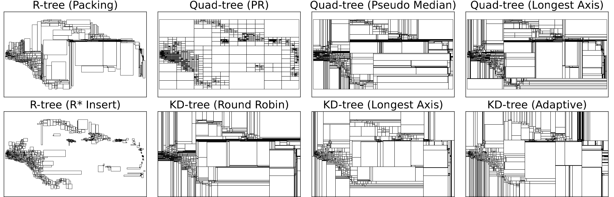
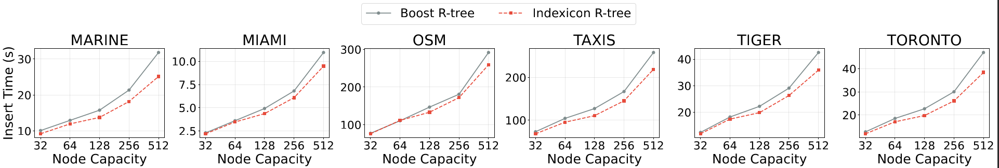
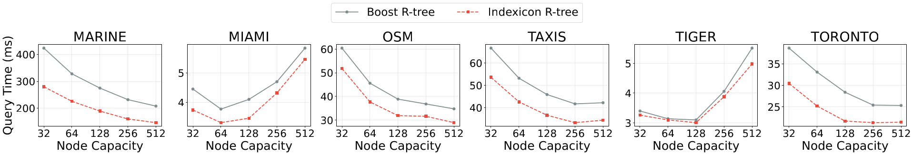

[](https://arxiv.org/abs/2606.04676)
[](https://pypi.org/project/indexicon/)

# Indexicon

I often need to modify or benchmark a spatial index. Unfortunately, most implementations are complex or lack features. That's why I made Indexicon, a drop-in library with state-of-the-art performance. It features:
- Highly efficient R-tree, Quad-tree, and KD-tree single-header C++ implementations.
- A unified API for packing, insertion, deletion, range queries, kNN queries, and statistics.
- Native support for point and minimum bounding box (MBB) data.
- A pip-installable Python API combining NumPy convenience with native C++ performance.


## Supported Indexes



| Index | File | Dims | Data Type | Description |
| :--- | :--- | :---: | :---: | :--- |
| **R-tree** | `rtree_point.hpp`, `rtree_mbr.hpp` | Any | Point / MBB | It decouples internal and leaf node capacities. It features top-down packing, R* insertions, and deletions that dissolve sparse nodes and reinsert orphans. `rtree_point.hpp` and `rtree_mbr.hpp` are implementations for point and MBB data, respectively. |
| **Quad-tree** | `quadtree.hpp` | 2D | Point | It supports three splitting strategies: Point-Region (PR) (geometric midpoints), Pseudo-median (independent axis medians), and Longest-axis (median of the widest span). It features bulk-loading, out-of-bounds insertions, and leaf overflows to handle duplicate points. |
| **MX-CIF Quad-tree** | `mxcif_quadtree.hpp` | 2D | MBB | It uses PR splits and stores boundary-straddling MBBs in internal nodes. |
| **Oct-tree** | `octtree.hpp` | 3D | Point | 3D extension of the PR Quad-tree dividing space into equal octants. |
| **KD-tree** | `kdtree.hpp` | Any | Point | It supports bucket leaves and three splitting strategies: Round-robin, Adaptive (widest data spread), and Longest-axis (widest bounding box). Packing recursively halves data at the median coordinate. Insertions/deletions handle leaf overflows/underflows. |





> For a comprehensive benchmark refer to our [paper](https://arxiv.org/abs/2606.04676).


## Quick Start

Copy a header from `indexes/` into your project and use it:

```cpp
#include "indexes/rtree_point.hpp"

int main() {
    using Tree = RTree<size_t, double, 2>;  // id type, coordinate type, dimensions
    using Pt = Tree::PointType;

    std::vector<std::pair<Pt, size_t>> data = {{Pt(1, 1), 0}, {Pt(2, 3), 1}, {Pt(5, 4), 2}};
    Tree tree(data.begin(), data.end());  // bulk-load

    tree.insert(Pt(3, 3), 3);
    tree.remove(Pt(1, 1), 0);

    Tree::BoxType box;
    box.minCorner = Pt(0, 0);
    box.maxCorner = Pt(4, 4);
    std::vector<size_t> hits;
    tree.query(box, std::back_inserter(hits));  // range query

    std::vector<size_t> nn;
    tree.knnQuery(Pt(0, 0), 2, std::back_inserter(nn));  // 2 nearest neighbors
}
```

To test all indexes:

```bash
unzip data/input/sample_data.zip -d data/input
./tests/run_all.sh
```


## Python Library

If you want to use Indexicon in Python:

```bash
pip install indexicon
```

See the [Python documentation](python/README.md) for details.


## Project Structure
- `indexes/`: index implementations (one header per index).
- `python/`: Python bindings, tests, and examples.
- `tests/`: C++ tests for every index, in 2D and 3D.
- `data/`: sample data.

## Manual Compilation

Requirements: a C++17-compatible compiler.

**Compile and run a single test:**
```bash
cd tests
g++ -std=c++17 -O3 -o rtree/rtree_point_2d.exe rtree/rtree_point_2d.cpp
./rtree/rtree_point_2d.exe
```

The tests are the best usage examples for data loading, inserts, deletes, range and kNN queries, and getting index statistics.


## Contributing
Contributions are welcome. Before a pull request, please ensure that:
1. **No dependencies**: indexes rely solely on the C++ standard library.
2. **Templates**: indexes can be adapted to different data types.
3. **Single-header**: every index is a standalone `.hpp` file.

*Hopefully, Indexicon will grow into a grimoire of indexes, expanded by those brave enough to peer into the geometry of the unknown.*

## License

This project is licensed under the MIT License. See [LICENSE](LICENSE) for details.

## Reference

If you use Indexicon in a project, paper, benchmark, or product, please cite:

```bibtex
@misc{simatis2026indexiconspatialindexinglibrary,
      title={Indexicon: A Spatial Indexing Library}, 
      author={Panagiotis Simatis and Panagiotis Bouros and Nikos Mamoulis},
      year={2026},
      eprint={2606.04676},
      archivePrefix={arXiv},
      primaryClass={cs.DB},
      url={https://arxiv.org/abs/2606.04676}, 
}
```

Indexicon's paper is available on arXiv: https://arxiv.org/abs/2606.04676
